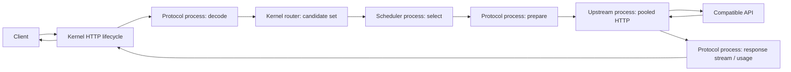

# Architecture

Positioning review (baseline `a3f011d`): ModuAPI is an experimental **AI HTTP
gateway construction kernel**, with a small mandatory business-domain surface.
Runtime/deployment/latency lightness is not assumed. [ADR 0009](adr/0009-moduapi-positioning.md)
pauses new plugin kinds pending [architecture validation](roadmap.md). See the
[comparison audit](research/competitive-architecture-audit.md) and
[E2E measurements](benchmarks/end-to-end.md). The implementation below is retained;
this audit changes no production boundary.

ModuAPI 0.1.0 implements an opaque-payload AI HTTP kernel and three versioned plugin service kinds. The envelope still knows models and token-shaped usage; it is not a universal protocol runtime. Official implementations are processes, not imports into the host executable.

## Dependency boundary

| Area | Owns | May depend on |
|---|---|---|
| `core/` | HTTP lifecycle, route matching, replay safety, deadlines, framing, hooks, config | SDK, generic HTTP hygiene, stdlib/YAML |
| `sdk/`, `proto/`, `gen/` | Language-neutral v1 SPI, Go server helper and wire aliases | protobuf/gRPC, stdlib |
| `runtime/` | Manifests, child lifetimes, negotiation, registry, RPC adapters | SDK, stdlib, gRPC/YAML |
| `plugins/official/` | Protocol parsing/mapping/usage, HTTP transport, selection policy | SDK, stdlib, generic header helper |
| `internal/app/`, `cmd/` | Composition, CLI, server startup/drain | Core and runtime |

The kernel never imports an official plugin. It knows neither plugin IDs nor OpenAI paths. Endpoint declarations arrive via handshake. Registry lookups are by negotiated kind and configured ID. No business repositories or persistent state exist.

## Canonical envelope

`Request` holds request ID, protocol ID, model, stream flag, method/path, headers, opaque body and string metadata. It carries no vendor message DTOs, user model, account entity or billing data. Method/path describe the prepared transport operation, supplied by the protocol plugin. `protocol.openai` recognizes `/v1/chat/completions` and prepares `/chat/completions`; the HTTP plugin joins that operation with its configured base URL.

Requests are buffered once at ingress with a default 4MiB cap (configurable up to 8MiB). Each attempt gets an independent HTTP body reader. Unmapped payloads preserve original bytes and unknown fields. Explicit model mapping rewrites JSON inside the protocol plugin; it preserves unknown values but not original key order/whitespace. The client model remains canonical; the mapped model is an upstream detail.

gRPC necessarily serializes/copies opaque bodies across processes, including the initial response-transform context. This is not a zero-copy design. Large uploads and disk spooling are future work; correctness comes before optimization.

## Lifecycle

1. Resolve protocol endpoint, create context, request ID and total deadline.
2. Run ingress hooks; enforce body cap and read deadline.
3. Protocol `Decode` validates input and returns a canonical envelope.
4. Emit decoded hook; router returns the first matching route's candidate set.
5. Emit routed hook; scheduler selects from configured candidates, receiving metadata, in-flight counts, exclusions and attempt number.
6. Validate selection; track in-flight; emit selected hook; call protocol `Prepare` with opaque per-upstream protocol options.
7. Upstream `Execute` produces headers/data/end-or-failure frames.
8. Before committing a response, classify HTTP failures and consult the independent replay policy.
9. Protocol `Transform` consumes response frames, may translate them, observes usage and produces downstream frames. The host validates both frame sequences.
10. Commit headers only when first data/end is available, write bounded frames, flush streaming responses, and apply idle/write/total deadlines.
11. Release in-flight count, report result/lease to scheduler, emit attempt-end and complete hooks with best-effort usage.

Ingress hooks are the future auth extension point. This slice has no runnable authenticator/middleware/storage/usage-observer RPC service. Existing hooks are trusted, in-process composition callbacks, not a claim that those future process APIs are complete. They must honor context and avoid blocking. Post hooks and scheduler release use an independent one-second cleanup budget after request cancellation; they do not keep the upstream running.

## Routing, selection and retries

The router contains no scoring. Candidate metadata can express priority, weight, health, latency, load, queue depth or error rate without teaching the host a scoring algorithm. These are opaque plugin-owned facts; the host currently adds only process-local in-flight counts. No upstream health/circuit-breaker policy is built in.

Single selects the first candidate not excluded. Round robin uses a mutex-protected counter per route, then chooses among unexcluded candidates. It is process-local and resets on restart. Neither policy weighs candidates or waits for capacity. Scheduler `Report` provides the extension point for health feedback and lease release. `Selection.lease` is opaque; plugins implementing concurrency must make release idempotent and use expiring leases because crashes can lose a report.

An opaque request metadata hint plus the experimental `SessionAffinity` interface allow scheduler plugins to derive/version their own sticky keys. No session/conversation/cache field names are hardcoded in the kernel. The new priority-weight-health plugin owns bounded health, admission leases and HMAC sticky state; see [its algorithm](design/scheduler.md). The OpenAI protocol can map an explicit affinity header to the opaque hint. A sticky implementation must respect `excluded_ids`; the host independently rejects repeated or out-of-route selections. Each attempted candidate is used at most once in this slice.

Replay is disabled by default. Opt-in uses `retry: {max_attempts: 2, allow_replay: true}` on a route, capped at eight attempts and the number of candidates. Only transport/timeout and HTTP 429/502/503/504 are eligible before commitment. Local, plugin, protocol and downstream errors are terminal. Retry can duplicate billable work even without any returned bytes; opting in accepts that risk. There is no exactly-once guarantee or automatic same-candidate replay.

## Streaming and cancellation

Frames are `start → data* → end`, or a terminal failure at any point. A data frame is at most 32KiB. EOF without a terminal is a failure. SSE is streamed incrementally through HTTP and bounded gRPC flow control, with one host forwarding goroutine per protocol stream and no unbounded queue. The consumer owns and closes both RPC streams; close cancels calls and joins forwarding work.

The OpenAI plugin parses LF/CRLF SSE incrementally (1MiB line/event limit), observes usage, requires `[DONE]`, and completes on that terminal event without waiting indefinitely for socket EOF. Missing terminal or an error event causes failure. It never fabricates `[DONE]`. Non-stream JSON observation is capped at 4MiB, independent of the ingress cap. Already-forwarded JSON cannot be replaced if later validation fails.

| Limit | Default | Scope |
|---|---|---|
| Request timeout | 5m | Ingress through response; also maximum stream duration |
| First-byte timeout | 30s | Upstream execute through first transformed body data/end, including header wait |
| Idle timeout | 30s | Each wait for the next transformed frame after commitment |
| Write timeout | 15s | Each downstream write/flush; cancellation also unblocks writes |
| Header read timeout | 5s | HTTP server |
| Process startup | 5s | Bootstrap/handshake/config/health; OS process creation can add platform latency |
| Plugin shutdown | 2s/process | RPC graceful stop followed by kill/reap |
| HTTP server drain | 10s | In-flight requests, then forced cancellation/close |

On client disconnect: HTTP context cancels → gRPC contexts cancel → HTTP plugin cancels `net/http` request → response bodies close. There is no background drain to recover billing usage. Partial usage is best effort and marked partial. Timers, stream senders, processes and connections have explicit cleanup paths.

After response commitment, any further failure aborts the HTTP response (`http.ErrAbortHandler`): HTTP/1 clients see a truncated body; HTTP/2 clients see a reset. There is no retry, second upstream prefix or synthetic success. Even header commitment is treated conservatively as irreversible.

The HTTP plugin owns one pooled transport per process (100 idle, 32 idle/host, 64 active/host), dial/TLS/header limits and connection cleanup. It does not follow redirects or inherit proxy settings. It strips hop-by-hop headers, ingress credentials and cookies. The only credentials it emits come from its own configuration and granted environment.

## Runtime availability

Bundles are discovered deterministically. Manifest requirements and RPC descriptions must agree. Capability lists are mandatory requirements, not silent best-effort toggles. A plugin is ready after configure/health. A health poll runs every five seconds with a one-second budget. Exit is observed independently; unavailable processes fail closed and make `/readyz` unavailable. `/healthz` only reports that the HTTP kernel is alive.

Startup failure rolls back earlier children. Failed startup is killed immediately, since there is nothing to drain. `Manager.Restart` explicitly stops/reaps before replacing a process; it rejects changed descriptions/bindings. Proxies resolve the current process on each call. Unexpected ready-process exits receive bounded backoff/restart with five-crashes/60s protection; a replacement startup failure stops recovery. Intentional shutdown/restart does not count. There is no hot reload. Runtime diagnostics retain only bounded closed-vocabulary stderr events, never arbitrary log text. See ADR 0008. Parent stdin closure stops SDK child servers after host death. This is not process-tree containment for arbitrary grandchildren.

See ADRs [0001](adr/0001-core-boundary.md), [0002](adr/0002-plugin-runtime.md), [0003](adr/0003-request-lifecycle.md), [0004](adr/0004-protocol-upstream-separation.md), [0005](adr/0005-scheduler-boundary.md) and the [roadmap](roadmap.md).

Phase 2 freezes the [cross-language contract](plugin-contract.md) through a real Python process and keeps protobuf v1 fields/services unchanged. Native binaries and interpreter scripts share lifecycle/registry semantics. ADRs [0006](adr/0006-cross-language-plugin-contract.md), [0007](adr/0007-scheduler-policy-and-admission.md), [0008](adr/0008-runtime-supervision-and-private-diagnostics.md) record these extensions.
