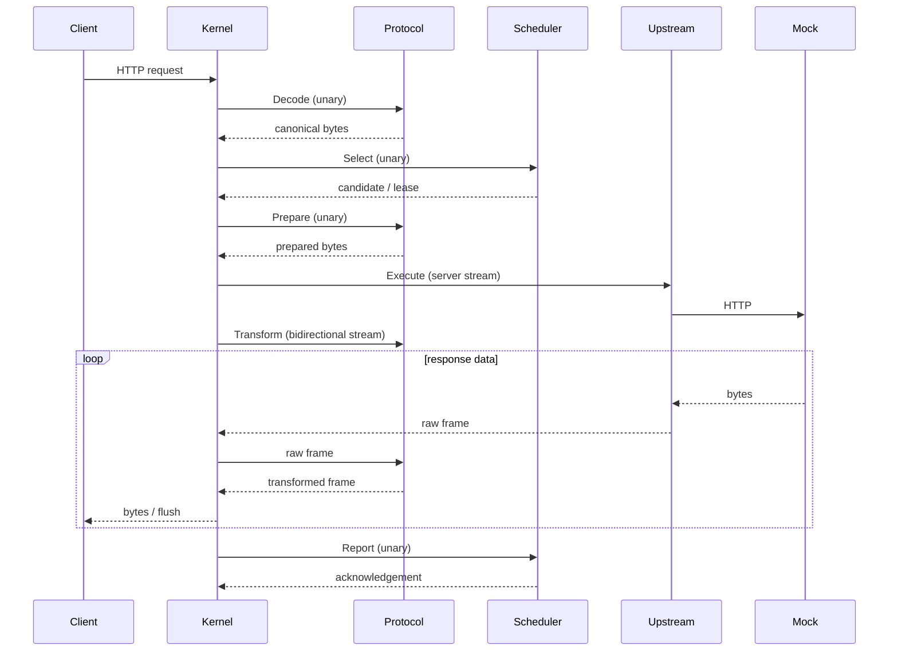

# End-to-end architecture cost

Audit date: 2026-10-16. Production baseline: `a3f011d405785886a5c723979d28b9ec78f61739`.
This is a measurement of the existing architecture, not a production optimization.
See the [source/positioning audit](../research/competitive-architecture-audit.md)
and [ADR 0009](../adr/0009-moduapi-positioning.md).

## Reproduce

```bash
make bench-e2e
# Or, without make:
go run ./tools/bench-e2e -concurrency 1,16,64 -duration 5s -warmup 1s -repeats 3
```

The harness builds official bundles once, then creates fresh helper/plugin
processes for each case. `-build=false -bundles <directory>` reuses binaries.
Output defaults to an OS-named file. Use `-out <file>` to preserve another run; do not overwrite the checked-in result
when comparing machines. For Linux, choose an appropriately named output file.
No real credentials, external model endpoint, Python dependency or database is used.
The full run takes approximately ten minutes on this workstation.

The gateway helper uses unchanged `internal/app.Start`, Gateway, registry, runtime
and **real official plugin executables**, not in-memory SPI mocks. It copies exactly
the requested three bundles into a temporary directory. The reference CLI's stock
directory contains all five official bundles and starts **six** service processes;
this experiment deliberately measures the requested minimal **four**. That
packaging discrepancy is documented debt, not a production fix hidden in the test.

## Workload and timing boundaries

Four topologies: direct HTTP to the mock, or kernel + protocol.openai + upstream.http
and one of scheduler.single / scheduler.roundrobin / scheduler.priority-weight-health.
Each gateway has the same two candidates pointing to the same mock; no retries,
affinity or capacity constraints. Advanced scheduling uses default configuration
and healthy candidates. This measures basic policy overhead, not stressed leases,
cooldowns or sticky concentration.

Each request contains a 1,024-byte message plus OpenAI JSON framing. JSON returns
about 1KiB of content after a nominal 1ms work delay. SSE flushes four 256-byte
content chunks with nominal 1ms inter-chunk gaps, then usage and `[DONE]`. These
are incremental responses, not a buffered response presented as SSE. Timers are
measured; their nominal delay is never substituted for actual elapsed work.

Closed-loop concurrency is 1, 16 or 64 workers; each case has 1s warmup and 5s
measurement plus completion of in-flight requests. Each worker starts its next
request after completion/validation of the previous one. RPS uses actual wall
duration, including the completion tail. Connections are reused; downstream and
upstream are loopback HTTP/1.1 without TLS, and plugin RPC is loopback gRPC/TCP.
There is no open-loop arrival rate, coordinated-omission correction, WAN latency,
large body, slow consumer, saturation sweep or long-running leak claim here.
Load generation and target processes share the workstation.

Three repetitions use fresh processes and rotate topology order. Tables report
the **median of three per-repetition statistics**, not percentiles of a pooled
request sample. Every per-repetition statistic, sample count and error count is in
[the raw result](end-to-end-windows.json). This short desktop experiment cannot
support an SLA, a small scheduler ranking, or a comparison with competing gateways.

The client records request start, first **body byte** and body EOF, before response
JSON/SSE parsing. The mock embeds its own elapsed work and first-byte work durations
in otherwise opaque response fields. Definitions, for request i:

```text
total_i          = client EOF - client start
first_i          = client first body byte - client start
residual_i       = total_i - mock measured work_i
first_residual_i = first_i - mock measured first-byte work_i
added_q         = median(gateway residual q) - median(direct residual q)
```

Residual includes forwarding, request parsing, final response serialization/writes,
network transit, scheduling/guards/timers, plugin IPC and queueing. The mock work
interval itself includes intermediate SSE serialization/writes and any backpressure
there. Thus subtraction removes measured upstream elapsed time, not just nominal
sleep. `added_q` is a **difference of quantiles from independent workloads**, not
the quantile of paired causal request differences. Percentiles are not additive.
Total latency, residual and direct reference are all retained to expose that limit.

On this Windows Go toolchain, the initial coarse-clock experiment produced
quantized residuals, including many zeros. It was discarded. The committed run
uses Windows QueryPerformanceCounter for both client and mock intervals; see
[Microsoft's interval-timing contract](https://learn.microsoft.com/en-us/windows/win32/api/profileapi/nf-profileapi-queryperformancecounter)
and the harness's platform clock. Linux uses Go's monotonic clock. Production
timers/clock code is unchanged. CPU time uses OS process accounting, not QPC.

## RPC and copy inventory



An ordinary successful first attempt uses **six business RPCs**: four unary,
two streaming. Lifecycle/health calls are additional background work. The request
body is serialized in six wire legs: Decode request/reply, Prepare request/reply,
Execute input and Transform initialization. Each raw response data chunk follows
upstream鈫抙ost鈫抪rotocol鈫抙ost, three gRPC payload legs. Streams overlap; six RPCs
do not imply six packets or a constant number of kernel context switches.

This run does **not** isolate protocol-only/scheduler-only/upstream-only IPC or
compare an in-process ablation. Dividing total added latency by six would be
incorrect. Component-local scheduler benchmarks answer a different question.

## Resource scope

- Direct row: the **mock process alone**, one process.
- Gateway row: **kernel helper + three plugins**, four processes; excludes the mock
  and load generator. The complete test topology also has those two processes.
- CPU is user+kernel seconds summed across that row's group during measurement;
  `cores = CPU seconds / elapsed seconds`, so 1.0 means one occupied logical core,
  not 100% of the entire 32-CPU machine. Direct and gateway CPU scopes differ and
  must not be subtracted as equivalent work.
- RSS is the sum of OS resident working sets, sampled every 200ms and at boundaries;
  it can miss short peaks and double-count shared pages. It is neither Go heap nor
  PSS. Gateway helper linking and its diagnostics wrapper slightly change the
  production executable's footprint, while the data path and plugin binaries remain
  unchanged. This is an assembly footprint estimate, not exact CLI private memory.
- Descriptor collection uses Windows process **handle counts**, not POSIX FDs.
  **FD count is N/A on this Windows run**. A Linux `/proc` collector supplies actual FDs in the separate WSL supplement;
  Windows results are not fabricated from handles.
- Goroutines are **host only** (the direct row reports mock goroutines), obtained
  from a benchmark-only HTTP endpoint every 200ms. Plugin goroutines are not
  observable through the v1 contract. Before means post-warmup with idle keepalive
  connections; after means client idle connections closed plus 250ms settling.
  Before/peak/after counts are diagnostics, not proof of no lifetime leak. Probes
  introduce a small amount of target HTTP work included in CPU measurements.
- Startup cost, binary download size, health/crash/restart stress and OS sandbox
  costs are not measured. Cleanup closes stdin, drains HTTP/runtime and waits for
  each child before proceeding to the next case.

## Measured results

Windows 11 Home China build 26200/amd64, Go 1.27.2, Intel Core i9-14900HX, 32 logical CPUs,
GOMAXPROCS=32, no race instrumentation. Started 2026-10-16 11:59:43 UTC.
**72 cases, 1,193,793 successful measured requests, zero errors.** All tables
below use median-of-three statistics. Units are ms unless indicated otherwise.

### Total request latency and completed RPS

Concurrency **1**.

| Mode | Topology | p50 | p95 | p99 | RPS |
|---|---|---:|---:|---:|---:|
| JSON | direct | 1.602 | 2.447 | 4.434 | 561.2 |
| JSON | single | 5.012 | 6.298 | 7.422 | 194.3 |
| JSON | roundrobin | 5.047 | 6.270 | 7.219 | 193.5 |
| JSON | priority-weight-health | 5.056 | 6.390 | 7.195 | 193.3 |
| SSE | direct | 6.458 | 8.549 | 12.252 | 146.7 |
| SSE | single | 9.866 | 11.898 | 13.271 | 99.3 |
| SSE | roundrobin | 9.754 | 11.403 | 13.147 | 99.1 |
| SSE | priority-weight-health | 9.746 | 11.402 | 12.403 | 100.2 |

Concurrency **16**.

| Mode | Topology | p50 | p95 | p99 | RPS |
|---|---|---:|---:|---:|---:|
| JSON | direct | 1.341 | 4.594 | 6.713 | 8306.0 |
| JSON | single | 6.507 | 8.743 | 10.053 | 2410.5 |
| JSON | roundrobin | 6.503 | 8.774 | 10.085 | 2407.9 |
| JSON | priority-weight-health | 6.541 | 8.825 | 9.988 | 2399.4 |
| SSE | direct | 6.258 | 10.953 | 13.763 | 2349.2 |
| SSE | single | 10.038 | 12.846 | 14.232 | 1568.0 |
| SSE | roundrobin | 9.902 | 12.697 | 13.984 | 1588.3 |
| SSE | priority-weight-health | 9.992 | 12.712 | 14.081 | 1578.6 |

Concurrency **64**.

| Mode | Topology | p50 | p95 | p99 | RPS |
|---|---|---:|---:|---:|---:|
| JSON | direct | 1.995 | 6.311 | 8.998 | 24474.7 |
| JSON | single | 15.136 | 21.828 | 25.631 | 4110.4 |
| JSON | roundrobin | 15.098 | 21.977 | 25.883 | 4120.9 |
| JSON | priority-weight-health | 15.148 | 22.131 | 25.712 | 4105.7 |
| SSE | direct | 5.465 | 11.747 | 14.689 | 9723.4 |
| SSE | single | 21.354 | 29.992 | 34.678 | 2933.9 |
| SSE | roundrobin | 21.250 | 30.484 | 35.579 | 2922.0 |
| SSE | priority-weight-health | 21.265 | 30.243 | 35.322 | 2929.5 |

### Upstream-work-adjusted residual and incremental estimate

`+p50/+p95/+p99` subtract the matching direct residual quantile; the direct
rows show residual reference values instead. This is not a paired estimator.

| Concurrency | Mode | Topology | Residual p50 | Residual p95 | Residual p99 | +p50 | +p95 | +p99 |
|---:|---|---|---:|---:|---:|---:|---:|---:|
| 1 | JSON | direct | 0.273 | 0.691 | 2.440 | N/A | N/A | N/A |
| 1 | JSON | single | 3.536 | 4.749 | 5.784 | 3.262 | 4.057 | 3.344 |
| 1 | JSON | roundrobin | 3.580 | 4.734 | 5.498 | 3.307 | 4.043 | 3.059 |
| 1 | JSON | priority-weight-health | 3.558 | 4.736 | 5.716 | 3.285 | 4.045 | 3.277 |
| 1 | SSE | direct | 0.277 | 0.952 | 2.451 | N/A | N/A | N/A |
| 1 | SSE | single | 3.492 | 4.766 | 5.858 | 3.215 | 3.814 | 3.407 |
| 1 | SSE | roundrobin | 3.414 | 4.547 | 6.225 | 3.138 | 3.595 | 3.774 |
| 1 | SSE | priority-weight-health | 3.480 | 4.505 | 5.422 | 3.203 | 3.553 | 2.971 |
| 16 | JSON | direct | 0.321 | 2.287 | 3.560 | N/A | N/A | N/A |
| 16 | JSON | single | 5.356 | 7.470 | 8.625 | 5.035 | 5.182 | 5.065 |
| 16 | JSON | roundrobin | 5.347 | 7.501 | 8.685 | 5.026 | 5.214 | 5.125 |
| 16 | JSON | priority-weight-health | 5.379 | 7.585 | 8.693 | 5.059 | 5.298 | 5.133 |
| 16 | SSE | direct | 0.538 | 2.624 | 5.007 | N/A | N/A | N/A |
| 16 | SSE | single | 4.825 | 7.260 | 8.527 | 4.287 | 4.635 | 3.519 |
| 16 | SSE | roundrobin | 4.795 | 7.170 | 8.397 | 4.257 | 4.545 | 3.390 |
| 16 | SSE | priority-weight-health | 4.767 | 7.069 | 8.198 | 4.229 | 4.445 | 3.191 |
| 64 | JSON | direct | 0.704 | 3.799 | 6.188 | N/A | N/A | N/A |
| 64 | JSON | single | 13.628 | 20.032 | 23.299 | 12.924 | 16.233 | 17.111 |
| 64 | JSON | roundrobin | 13.546 | 20.208 | 24.027 | 12.842 | 16.409 | 17.838 |
| 64 | JSON | priority-weight-health | 13.670 | 20.290 | 23.694 | 12.966 | 16.490 | 17.505 |
| 64 | SSE | direct | 0.305 | 2.372 | 4.039 | N/A | N/A | N/A |
| 64 | SSE | single | 14.468 | 21.943 | 26.205 | 14.163 | 19.571 | 22.166 |
| 64 | SSE | roundrobin | 14.417 | 22.573 | 26.838 | 14.112 | 20.200 | 22.799 |
| 64 | SSE | priority-weight-health | 14.415 | 22.149 | 26.691 | 14.110 | 19.776 | 22.652 |

### First body byte at concurrency 16

SSE first-byte latency is measured independently of stream completion. The raw
file also contains all first-byte distributions at concurrency 1 and 64.

| Mode | Topology | First p50 | First p95 | First p99 | First residual p50 | Added first residual p50 |
|---|---|---:|---:|---:|---:|---:|
| JSON | direct | 1.315 | 4.558 | 6.673 | 0.299 | N/A |
| JSON | single | 6.478 | 8.707 | 10.026 | 5.327 | 5.028 |
| JSON | roundrobin | 6.473 | 8.729 | 10.056 | 5.317 | 5.019 |
| JSON | priority-weight-health | 6.516 | 8.797 | 9.959 | 5.353 | 5.054 |
| SSE | direct | 1.662 | 4.638 | 7.048 | 0.449 | N/A |
| SSE | single | 5.586 | 7.804 | 8.964 | 4.444 | 3.995 |
| SSE | roundrobin | 5.560 | 7.675 | 8.729 | 4.420 | 3.972 |
| SSE | priority-weight-health | 5.553 | 7.718 | 8.747 | 4.386 | 3.937 |

### CPU, resident memory, handles and host goroutines

CPU seconds are summed process CPU during each approximately 5s case. RSS and
handles are sampled peaks, then median across repetitions. All rows have **FD=N/A**
on Windows. Goroutines are before / peak / after, host only; see scope above.

| C | Mode | Topology | Processes | CPU s | CPU cores | RSS MiB | Handles | Goroutines |
|---:|---|---|---:|---:|---:|---:|---:|---|
| 1 | JSON | direct | 1 | 0.84 | 0.17 | 19.5 | 186 | 5 / 6 / 4 |
| 1 | JSON | single | 4 | 6.11 | 1.22 | 160.9 | 817 | 32 / 34 / 31 |
| 1 | JSON | roundrobin | 4 | 6.25 | 1.25 | 160.3 | 817 | 32 / 34 / 31 |
| 1 | JSON | priority-weight-health | 4 | 6.36 | 1.27 | 162.3 | 815 | 32 / 34 / 31 |
| 1 | SSE | direct | 1 | 0.62 | 0.12 | 19.0 | 186 | 5 / 6 / 4 |
| 1 | SSE | single | 4 | 5.06 | 1.01 | 161.3 | 805 | 32 / 36 / 31 |
| 1 | SSE | roundrobin | 4 | 5.31 | 1.06 | 160.7 | 807 | 32 / 36 / 31 |
| 1 | SSE | priority-weight-health | 4 | 5.39 | 1.08 | 160.6 | 811 | 32 / 36 / 31 |
| 16 | JSON | direct | 1 | 7.95 | 1.59 | 27.1 | 362 | 20 / 36 / 4 |
| 16 | JSON | single | 4 | 44.98 | 8.99 | 134.2 | 1133 | 47 / 82 / 31 |
| 16 | JSON | roundrobin | 4 | 43.34 | 8.66 | 134.3 | 1129 | 47 / 79 / 31 |
| 16 | JSON | priority-weight-health | 4 | 44.28 | 8.85 | 133.6 | 1138 | 47 / 81 / 31 |
| 16 | SSE | direct | 1 | 5.47 | 1.09 | 24.1 | 281 | 20 / 36 / 4 |
| 16 | SSE | single | 4 | 42.80 | 8.54 | 133.8 | 1124 | 47 / 102 / 31 |
| 16 | SSE | roundrobin | 4 | 42.45 | 8.47 | 133.5 | 1102 | 47 / 102 / 31 |
| 16 | SSE | priority-weight-health | 4 | 42.55 | 8.49 | 135.0 | 1109 | 47 / 107 / 31 |
| 64 | JSON | direct | 1 | 30.06 | 6.00 | 33.0 | 454 | 72 / 134 / 4 |
| 64 | JSON | single | 4 | 53.95 | 10.77 | 151.1 | 1416 | 95 / 235 / 31 |
| 64 | JSON | roundrobin | 4 | 53.70 | 10.72 | 153.9 | 1419 | 95 / 222 / 31 |
| 64 | JSON | priority-weight-health | 4 | 54.72 | 10.92 | 150.9 | 1395 | 95 / 224 / 31 |
| 64 | SSE | direct | 1 | 24.38 | 4.86 | 30.5 | 429 | 69 / 134 / 4 |
| 64 | SSE | single | 4 | 51.81 | 10.32 | 154.9 | 1435 | 95 / 267 / 31 |
| 64 | SSE | roundrobin | 4 | 51.97 | 10.36 | 156.3 | 1445 | 95 / 282 / 31 |
| 64 | SSE | priority-weight-health | 4 | 52.36 | 10.44 | 154.3 | 1460 | 95 / 261 / 31 |

The largest individual gateway RSS sample across all repetitions was 203.7 MiB
(scheduler.roundrobin, SSE, C=1, repetition 3);
median tables must not be read as hard upper bounds.


### WSL Linux FD supplement (exploratory)

A separate **single repetition**, concurrency 16, uses Go 1.27.2 Linux/amd64
binaries cross-compiled with CGO_ENABLED=0 and no race instrumentation. Environment:
Docker Desktop WSL2, kernel `6.18.33.2-microsoft-standard-WSL2`, the same i9-14900HX,
32 logical CPUs/GOMAXPROCS=32. Binaries were launched from the mounted Windows
workspace; temporary plugin copies live on the Linux filesystem. Tests/builds
finished before measurement. This is **not** the dedicated native Linux validation
gate. VM scheduling, memory accounting and one fixed topology order prevent
cross-OS performance rankings or a robust scheduler comparison.

**8 cases, 129,773 successful measured requests, zero errors.** The same harness,
mock, 1s warmup and 5s measurement apply. Raw first-byte/residual/resource metrics:
[end-to-end-wsl.json](end-to-end-wsl.json). These are single-run statistics, not
median-of-three. Direct CPU/RSS/FD scope is mock only; gateway scope is the four
service processes, excluding mock, load generator and the rest of the WSL VM.

| Mode | Topology | Total p50 | Total p95 | Total p99 | RPS | Added residual p50 | Added residual p95 |
|---|---|---:|---:|---:|---:|---:|---:|
| JSON | direct | 1.760 | 2.403 | 2.749 | 8882.8 | N/A | N/A |
| JSON | single | 4.962 | 6.302 | 7.000 | 3187.9 | 3.310 | 3.997 |
| JSON | roundrobin | 5.060 | 6.575 | 7.416 | 3106.2 | 3.411 | 4.271 |
| JSON | priority-weight-health | 5.810 | 7.916 | 9.531 | 2683.0 | 4.138 | 5.638 |
| SSE | direct | 5.831 | 6.788 | 7.420 | 2704.1 | N/A | N/A |
| SSE | single | 8.788 | 10.600 | 11.405 | 1803.3 | 3.175 | 4.357 |
| SSE | roundrobin | 9.085 | 11.015 | 12.100 | 1739.6 | 3.454 | 4.785 |
| SSE | priority-weight-health | 8.674 | 10.524 | 11.496 | 1822.7 | 3.070 | 4.208 |

| Mode | Topology | Processes | CPU s | CPU cores | RSS MiB | POSIX FD peak | Host goroutines before / peak / after |
|---|---|---:|---:|---:|---:|---:|---|
| JSON | direct | 1 | 5.33 | 1.07 | 18.0 | 23 | 20 / 36 / 4 |
| JSON | single | 4 | 38.97 | 7.79 | 75.2 | 75 | 47 / 77 / 31 |
| JSON | roundrobin | 4 | 39.28 | 7.85 | 79.0 | 75 | 47 / 87 / 31 |
| JSON | priority-weight-health | 4 | 40.69 | 8.13 | 74.5 | 75 | 47 / 79 / 31 |
| SSE | direct | 1 | 2.88 | 0.58 | 17.8 | 23 | 20 / 36 / 4 |
| SSE | single | 4 | 31.89 | 6.37 | 75.4 | 75 | 47 / 104 / 31 |
| SSE | roundrobin | 4 | 32.94 | 6.58 | 77.8 | 75 | 47 / 111 / 31 |
| SSE | priority-weight-health | 4 | 31.14 | 6.22 | 76.0 | 75 | 47 / 109 / 31 |

The Linux `/proc/<pid>/fd` collector measures actual FDs: **23** for the direct
target, **75** summed across each gateway group in this run. These are observed
peaks, not a capacity limit. Gateway incremental residual p50 remains approximately
**3.1-4.1ms** and p95 **4.0-5.6ms**. The Linux RSS values differ substantially from
Windows working sets, reinforcing why a universal "low memory" claim is premature.
All host after-counts are again 31 for gateways / 4 direct. No long-duration leak
or native-Linux SLA claim follows.

To repeat the same workload on a Linux host with Go installed:

```bash
CGO_ENABLED=0 go run ./tools/bench-e2e -concurrency 16 -duration 5s \
  -warmup 1s -repeats 1 -out docs/benchmarks/end-to-end-linux.json
```

## Interpretation and limits

The minimal isolated assembly adds about **3.1-3.3ms p50 / 3.6-4.1ms p95**
at concurrency 1 after subtracting the direct residual reference. At concurrency
16 the estimated increment is about **4.2-5.1ms p50 / 4.4-5.3ms p95**; at concurrency
64 it grows to roughly **12.8-14.2ms p50 / 16.2-20.2ms p95**. These ranges span the
three policies and both response modes; they are this workload's observed cost,
not a constant surcharge or isolated IPC time.

At concurrency 16, JSON completes about **2,400 RPS** through the gateway versus
**8,306 RPS** direct; SSE about **1,568-1,588 RPS** versus **2,349 RPS** direct.
The gateway group consumes approximately **8.5-9 logical CPU cores** during that
closed-loop load, with median sampled RSS approximately **133-135MiB**. At concurrency
1 the gateway RSS is around **160-162MiB**; GC/pacing and short-run variability mean
RSS need not increase monotonically with concurrency. The individual maximum is
reported above rather than hidden by the median.

Policy-to-policy differences are small relative to this whole path and experiment
variation. No scheduler winner is established. The direct JSON C=16 RPS itself
ranges from 6,964 to 8,871 between repetitions, a warning against false precision.
High concurrency increases queueing and total path cost; a scheduler microbenchmark
cannot explain that increment without profiling and controlled ablations.

Every completed gateway case reports 31 host goroutines after closing client idle
connections; direct cases report 4. Each fresh helper/plugin group is reaped between
cases. This is a useful cleanup observation, **not** a continuous leak test or a count
of plugin goroutines. Existing cancellation/conformance tests are separate evidence.

The result does not support calling this topology low-latency, low-memory or
single-binary. Its current substantiated lightness is the absence of mandatory
business services. For local inference with a sub-ms gateway budget, this assembly
has not demonstrated an acceptable execution profile. For long WAN inference the
same milliseconds may be acceptable only if component isolation has real value.


Do not infer that a competitor is faster from architecture diagrams or published
marketing numbers. No competitor was run under this harness. Do not infer that
the full increment is gRPC overhead: the direct path omits the entire gateway.
An acceptable cost depends on the local inference latency budget and whether
independent release/language/fault boundaries are an actual requirement.

Before changing architecture, repeat on a dedicated Linux host, capture CPU/heap
profiles, add large bodies/long streams/slow consumers/cancellation storms, and
compare a multi-service bundle with a temporary in-process control. The existing
contract already allows several service roles in one plugin process. Execution
placement and logical component separation are different decisions. No production
refactor or new plugin kind is justified by this run alone.
